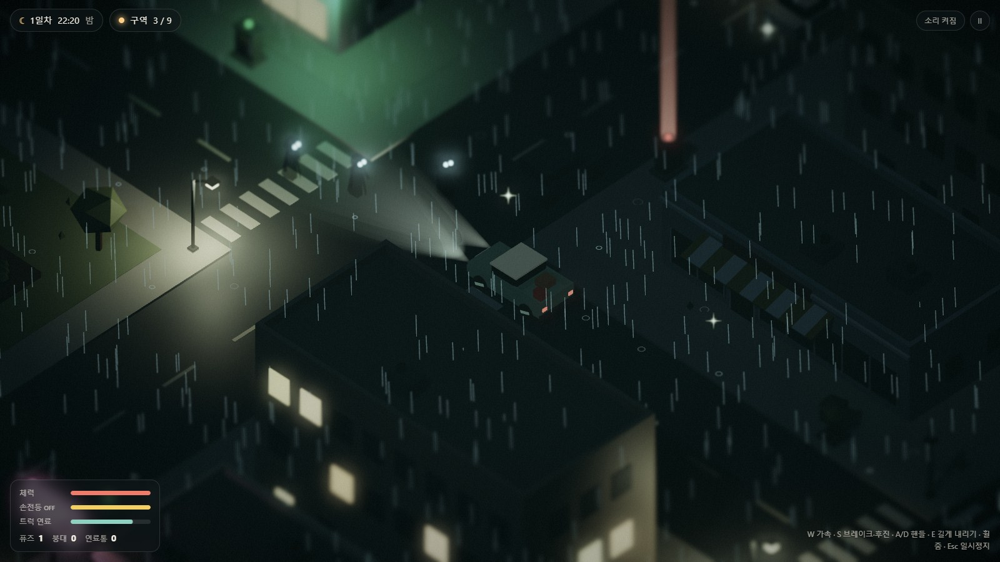

# Lumen Hollow — 빛으로 버티는 밤

정전된 작은 마을. 낮에는 골목을 뒤져 퓨즈를 모으고, 밤에는 손전등과 가로등 불빛에 기대 어둠 속 **그늘이**를 버틴다. 꺼진 배전함에 하나씩 퓨즈를 끼워 마을 전체에 다시 불을 밝히는 아이소메트릭 로우폴리 생존 게임 프로토타입입니다. 그날 밤 세상의 불이 꺼진 뒤, 할머니의 무전과 마을에 남은 생존자들의 기록을 따라가면 어둠이 어디서 시작됐는지와 마지막으로 켜야 할 불이 드러납니다.

**▶ 라이브 데모: https://jeiel85.github.io/lumen-hollow/** (설치 없이 브라우저에서 바로, 모바일 터치·가로/세로 화면 지원)

홈 화면·바탕화면에 **앱으로 설치**할 수도 있습니다(타이틀의 "앱으로 설치", iOS는 공유 → 홈 화면에 추가). 설치하면 주소창 없이 전체 화면으로 열리고, 한 번 받은 뒤에는 인터넷 없이도 할 수 있습니다.


| 아침 | 노을 |
|---|---|
|  |  |



## 어떻게 플레이하나요

| 시간 | 할 일 |
|---|---|
| **낮** | 마을을 돌며 반짝이는 곳을 뒤져 퓨즈·배터리·붕대·연료통을 모은다. 화살표와 붉은 신호 기둥이 가장 가까운 꺼진 배전함을 가리킨다. |
| **해질녘** | 불 켜진 구역 쪽으로 돌아온다. 첫날 밤에는 비가 내린다. |
| **밤** | 그늘이는 빛을 싫어한다. 켜진 가로등 불빛 안으로는 들어오지 못하고, 손전등으로 오래 비추면 흩어진다. 가로등 아래에서는 손전등이 충전되고 체력도 회복된다. |
| **트럭** | 은신처 앞 도로에 낡은 픽업트럭이 서 있다. 연료가 남은 동안 달릴 수 있고, 밤에는 전조등이 손전등처럼 그늘이를 태운다. 빠르게 들이받으면 흩어지지만, 멈춰 있으면 어두운 뒤쪽에서 다가온다. 연료는 달릴수록 줄고, 주운 연료통은 트럭에 탈 때 부어 넣는다. 퓨즈를 끼우거나 뒤지려면 내려야 한다. |
| **목표** | 배전함 8곳에 퓨즈를 끼워 9개 구역 모두에 불을 켠다. 구역을 살릴 때마다 그 동네의 가로등·창문·네온사인이 밤에 함께 켜진다. |
| **옷장** | 처음 화면의 '옷장'에서 비옷 색·모자·안경·배낭을 고른다. 처음엔 몇 가지만 있고, 나머지는 판마다 마을 어딘가에 크림색 빛기둥과 함께 떨어진 꾸러미(최대 3개)를 주우면 이 브라우저에 영구히 남는다. 능력치 없는 순수 외형이다. |
| **이야기** | 첫 판을 시작하면 할머니에게서 무전이 오고, 구역에 불이 들어올 때마다 다음 무전이 온다. 무전이 열어 준 기록은 **푸른 빛기둥**과 화면 밖 **푸른 화살표**가 가리킨다. 가까이 가서 상호작용을 길게 누르면 읽는다. 본 장면과 읽은 기록은 이 브라우저에 남아 다음 판에도 이어지고, 일시정지·처음 화면의 **수첩**에서 다시 볼 수 있다. 장면은 화면을 누르거나 Space·Enter·E로 넘기고, Esc나 "건너뛰기"로 건너뛴다. |

### 조작

| 동작 | 키보드·마우스 | 터치 |
|---|---|---|
| 이동 | WASD / 방향키 | 왼쪽 화면 드래그(가상 스틱) |
| 조준 | 마우스 커서 | 이동 방향 |
| 손전등 | F 또는 클릭 | 손전등 버튼 |
| 뒤지기·퓨즈 끼우기 | E 또는 Space 길게 | 상호작용 버튼 길게 |
| 붕대 | Q | 붕대 버튼 |
| 트럭 타기·내리기 | 트럭 옆에서 E 길게 (내릴 때는 멈춘 뒤) | 상호작용(내리기) 버튼 길게 |
| 운전 | W 가속 · S 브레이크·후진 · A/D 핸들 | 가고 싶은 쪽으로 스틱(뒤로 당기면 후진) |
| 줌 / 일시정지 / 소리 | 휠 / Esc·P / M | 설정의 카메라 거리 / 화면 오른쪽 위 버튼 |
| 무전 넘기기 / 건너뛰기 | 클릭·Space·Enter·E / Esc | 화면 누르기 / 건너뛰기 버튼 |

휴대폰을 세로·가로로 돌리면 화면 배치가 바로 바뀝니다. 짧은 변에 보이는 범위를 같게 맞춰서 돌려도 캐릭터 크기는 그대로이고, 긴 변 쪽으로 시야만 넓어집니다.

### 설정

타이틀이나 일시정지 화면의 **설정**에서 바꾸고, 이 브라우저에 저장됩니다.

| 묶음 | 항목 |
|---|---|
| 소리 | 전체 음량, 환경음(비·밤 소리) |
| 화면 | 화질(낮음·보통·높음: 해상도·안티에일리어싱·그림자), 미니어처 흐림, 흔들림·붉은 점멸(움직임 줄이기를 켠 기기는 처음부터 꺼짐), FPS 표시, 전체 화면(지원하는 브라우저) |
| 조작 | 카메라 거리, 왼손 모드(터치: 스틱과 버튼 자리 바꾸기) |
| 앱 설치 | 설치 버튼 또는 브라우저별 설치 방법 안내 |
| 기록 | 최고 기록 보기, 파일로 내보내기·가져오기, 지우기 |

### 기록 보관

최고 기록은 이 브라우저에만 저장됩니다. 사이트 데이터를 지우거나 다른 기기·브라우저로 옮기면 따라오지 않으니, 설정 → 기록 → **내보내기**로 `.json` 파일을 받아 두고 새 곳에서 **가져오기** 하세요(가져오면 지금 기록과 합쳐 더 좋은 값이 남습니다). 브라우저가 공간 정리로 지우지 않도록 영구 저장도 요청합니다. 검토한 다른 방법(클라우드 동기화 등)과 이유는 [DECISIONS.md](DECISIONS.md)에 있습니다.

## 기술 구성

- **빌드 없는 정적 사이트**: 순수 ES 모듈 + [three.js](https://threejs.org/) r187(`vendor/three/`에 포함, MIT). `main`에 푸시하면 `.github/workflows/pages.yml`이 GitHub Pages로 배포한다.
- **캐시 무효화**: Pages는 모든 파일을 10분 캐시하므로, `index.html`의 진입 스크립트·스타일과 import map의 모듈 URL에 `?v=__BUILD__`를 붙이고 배포 워크플로가 커밋 SHA로 바꾼다. **`src/`에 모듈을 추가하면 import map과 `sw.js`의 `MODULES`에도 등록**해야 하며, 빠지면 배포가 실패한다.
- **PWA**: `manifest.webmanifest`(전체 화면, 방향 자유), `icons/`, 서비스 워커 `sw.js`. 페이지는 네트워크 우선, `?v=` 붙은 파일은 캐시 우선으로 오프라인 실행을 지원한다. 로컬 개발에서는 서비스 워커를 쓰지 않는다(`?sw`로 켬). 자세한 이유는 [DECISIONS.md](DECISIONS.md).
- **절차적 마을**: 5×5 블록(주택가·상가·약국·다이너·공원·농장·헛간·급수탑)을 고정 시드로 생성하고, 정적 지오메트리 수천 개를 정점 색상 메시 하나로 합쳐 드로우콜을 줄였다.
- **조명**: 시간대 키프레임(아침의 옅은 민트 → 오후의 주황 → 비 오는 밤의 청록)으로 해·달·환경광·색보정을 보간. 가까운 광원만 고정 개수의 PointLight로 비추고(셰이더 재컴파일 방지), 나머지는 인스턴싱한 빛 웅덩이로 표현.
- **후처리**: HDR 렌더 타깃 → 블룸 → 틸트시프트(미니어처 느낌) → 톤매핑·채도·비네트·그레인.
- **소리**: 음원 파일 없이 WebAudio로 빗소리·밤의 저음·효과음을 합성.

```
index.html, style.css   화면 골격과 HUD
src/main.js             게임 루프·상태·상호작용
src/world.js            마을 생성, 충돌, 구역 전력, 광원 풀
src/env.js              낮밤 주기, 해·달, 비
src/post.js             블룸·틸트시프트·색보정
src/player.js           캐릭터, 손전등
src/wardrobe.js         옷장: 옷가지 목록·저장, 모자·안경·배낭 모델, 마을에 떨어진 꾸러미, 옷장 화면
src/vehicle.js          탈 수 있는 트럭: 운전·충돌·전조등·연료·바퀴 자국
src/shades.js           그늘이(적) AI
src/input.js            키보드·마우스·터치
src/hud.js, audio.js    HUD, 합성 사운드
src/script.js           이야기 대본: 무전 장면과 마을 기록의 글(설정 요약은 docs/story.md)
src/story.js            이야기 진행 저장, 기록 소품·표식 배치, 호수와 등대 풍경
src/dialogue.js         무전 장면(대화 컷신)·기록 읽기·수첩 화면
src/settings.js         설정 저장·검증, 설정 화면 입력 연결
src/records.js          최고 기록, 기록 파일 내보내기·가져오기
src/pwa.js              서비스 워커 등록, 앱 설치 안내, 전체 화면
src/storage.js          localStorage 안전 접근
sw.js                   서비스 워커(오프라인 캐시)
manifest.webmanifest    PWA 설치 정보, icons/ 아이콘
```

## 로컬에서 실행

ES 모듈이라 `file://`로는 열리지 않습니다. 저장소 폴더에서 아무 정적 서버나 띄우면 됩니다.

```bash
python -m http.server 8000
```

브라우저에서 `http://localhost:8000` 을 엽니다.

### URL 파라미터

| 파라미터 | 설명 |
|---|---|
| `?hour=21` | 시작 시각(0~24). 밤 장면을 바로 보고 싶을 때 |
| `?start=1` | 타이틀을 건너뛰고 바로 시작 |
| `?debug` | 콘솔에 `window.lumen` 개발용 핸들을 노출(`lumen.step(초)`로 고정 간격 시뮬레이션) |
| `?sw` | 로컬 개발에서도 서비스 워커를 등록(오프라인·설치 시험용). 끌 때는 `?sw` 없이 다시 열면 해제된다 |

## 현재 상태와 다음 단계

반응을 보기 위한 프로토타입입니다. 데스크톱(RTX 5060, Chrome)에서 60fps를 확인했고, 저사양·실제 모바일 기기 성능은 아직 측정 전입니다. 견고성 개선 후보는 이슈 `Hardening candidates`에서 관리합니다.

반응이 괜찮으면 해 볼 만한 것들:

- 2장: 선착장의 나룻배를 타고 호수를 건너 등대의 할머니에게 가기
- 그늘이 종류 추가(빛을 꺼뜨리는 녀석, 무리 지어 다니는 녀석), 밤마다 달라지는 사건
- 은신처 꾸미기와 마을 사람 구출 같은 코지 요소
- 날씨(안개·눈), 계절에 따른 조명 변화
- 저장/이어하기, 맵 변형(시드 선택)

## 라이선스

**코드는 가져다 써도 되고, 콘텐츠는 원작자를 표시하면 쓸 수 있습니다.**

| 구분 | 해당하는 것 | 라이선스 |
|---|---|---|
| 코드 | `src/`, `index.html`, `style.css`, `sw.js` 등. 마을·모델·조명·소리를 만드는 코드 포함 | [MIT](LICENSE) |
| 콘텐츠 | 이미지(`docs/`, `icons/`, `favicon.svg`), 게임 속 글, 게임 이름·세계관·그늘이 같은 등장 요소 | [CC BY 4.0](LICENSE-CONTENT.md) |
| three.js | `vendor/three/` | MIT ([vendor/three/LICENSE](vendor/three/LICENSE)) |

콘텐츠를 쓸 때는 `"Lumen Hollow" © 2026 박용은 (jeiel85), CC BY 4.0`과 원본 주소를 적고, 고쳤다면 고친 사실도 밝혀 주세요. 경계와 표시 방법은 [LICENSE-CONTENT.md](LICENSE-CONTENT.md)에 있습니다.
