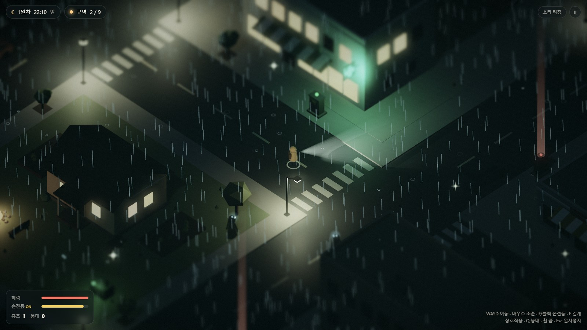
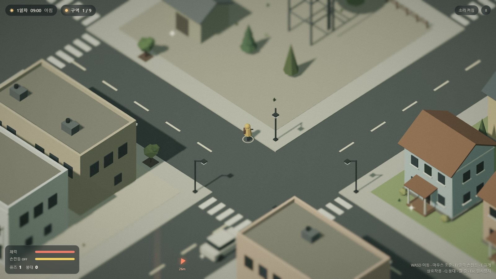
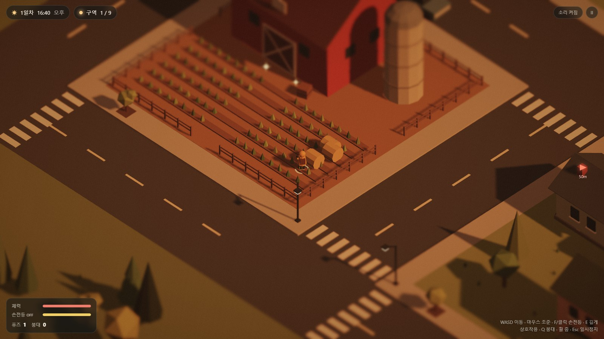

# Lumen Hollow — 빛으로 버티는 밤

정전된 작은 마을. 낮에는 골목을 뒤져 퓨즈를 모으고, 밤에는 손전등과 가로등 불빛에 기대 어둠 속 **그늘이**를 버틴다. 꺼진 배전함에 하나씩 퓨즈를 끼워 마을 전체에 다시 불을 밝히는 아이소메트릭 로우폴리 생존 게임 프로토타입입니다.

**▶ 라이브 데모: https://jeiel85.github.io/lumen-hollow/** (설치 없이 브라우저에서 바로, 모바일 터치 지원)



| 아침 | 노을 |
|---|---|
|  |  |

## 어떻게 플레이하나요

| 시간 | 할 일 |
|---|---|
| **낮** | 마을을 돌며 반짝이는 곳을 뒤져 퓨즈·배터리·붕대를 모은다. 화살표와 붉은 신호 기둥이 가장 가까운 꺼진 배전함을 가리킨다. |
| **해질녘** | 불 켜진 구역 쪽으로 돌아온다. 첫날 밤에는 비가 내린다. |
| **밤** | 그늘이는 빛을 싫어한다. 켜진 가로등 불빛 안으로는 들어오지 못하고, 손전등으로 오래 비추면 흩어진다. 가로등 아래에서는 손전등이 충전되고 체력도 회복된다. |
| **목표** | 배전함 8곳에 퓨즈를 끼워 9개 구역 모두에 불을 켠다. 구역을 살릴 때마다 그 동네의 가로등·창문·네온사인이 밤에 함께 켜진다. |

### 조작

| 동작 | 키보드·마우스 | 터치 |
|---|---|---|
| 이동 | WASD / 방향키 | 왼쪽 화면 드래그(가상 스틱) |
| 조준 | 마우스 커서 | 이동 방향 |
| 손전등 | F 또는 클릭 | 손전등 버튼 |
| 뒤지기·퓨즈 끼우기 | E 또는 Space 길게 | 상호작용 버튼 길게 |
| 붕대 | Q | 붕대 버튼 |
| 줌 / 일시정지 / 소리 | 휠 / Esc·P / M | 화면 오른쪽 위 버튼 |

## 기술 구성

- **빌드 없는 정적 사이트**: 순수 ES 모듈 + [three.js](https://threejs.org/) r187(`vendor/three/`에 포함, MIT). `main`에 푸시하면 `.github/workflows/pages.yml`이 GitHub Pages로 배포한다.
- **캐시 무효화**: Pages는 모든 파일을 10분 캐시하므로, `index.html`의 진입 스크립트·스타일과 import map의 모듈 URL에 `?v=__BUILD__`를 붙이고 배포 워크플로가 커밋 SHA로 바꾼다. **`src/`에 모듈을 추가하면 import map에도 등록**해야 하며, 빠지면 배포가 실패한다.
- **절차적 마을**: 5×5 블록(주택가·상가·약국·다이너·공원·농장·헛간·급수탑)을 고정 시드로 생성하고, 정적 지오메트리 수천 개를 정점 색상 메시 하나로 합쳐 드로우콜을 줄였다.
- **조명**: 시간대 키프레임(아침의 옅은 민트 → 오후의 주황 → 비 오는 밤의 청록)으로 해·달·환경광·색보정을 보간. 가까운 광원만 고정 개수의 PointLight로 비추고(셰이더 재컴파일 방지), 나머지는 인스턴싱한 빛 웅덩이로 표현.
- **후처리**: HDR 렌더 타깃 → 블룸 → 틸트시프트(미니어처 느낌) → 톤매핑·채도·비네트·그레인.
- **소리**: 음원 파일 없이 WebAudio로 빗소리·밤의 저음·효과음을 합성.

```
index.html, style.css   화면 골격과 HUD
src/main.js             게임 루프·상태·상호작용
src/world.js            마을 생성, 충돌, 구역 전력, 광원 풀
src/env.js              낮밤 주기, 해·달, 비
src/post.js             블룸·틸트시프트·색보정
src/player.js           캐릭터, 손전등
src/shades.js           그늘이(적) AI
src/input.js            키보드·마우스·터치
src/hud.js, audio.js    HUD, 합성 사운드
src/storage.js          localStorage 안전 접근
```

## 로컬에서 실행

ES 모듈이라 `file://`로는 열리지 않습니다. 저장소 폴더에서 아무 정적 서버나 띄우면 됩니다.

```bash
python -m http.server 8000
```

브라우저에서 `http://localhost:8000` 을 엽니다.

### URL 파라미터

| 파라미터 | 설명 |
|---|---|
| `?hour=21` | 시작 시각(0~24). 밤 장면을 바로 보고 싶을 때 |
| `?start=1` | 타이틀을 건너뛰고 바로 시작 |
| `?debug` | 콘솔에 `window.lumen` 개발용 핸들을 노출(`lumen.step(초)`로 고정 간격 시뮬레이션) |

## 현재 상태와 다음 단계

반응을 보기 위한 프로토타입입니다. 데스크톱(RTX 5060, Chrome)에서 60fps를 확인했고, 저사양·실제 모바일 기기 성능은 아직 측정 전입니다. 견고성 개선 후보는 이슈 `Hardening candidates`에서 관리합니다.

반응이 괜찮으면 해 볼 만한 것들:

- 그늘이 종류 추가(빛을 꺼뜨리는 녀석, 무리 지어 다니는 녀석), 밤마다 달라지는 사건
- 은신처 꾸미기와 마을 사람 구출 같은 코지 요소
- 날씨(안개·눈), 계절에 따른 조명 변화
- 저장/이어하기, 맵 변형(시드 선택)

## 라이선스

게임 코드와 에셋의 라이선스는 아직 정하지 않았습니다(별도 고지 전까지 All rights reserved). 포함된 three.js는 MIT 라이선스입니다(`vendor/three/LICENSE`).
