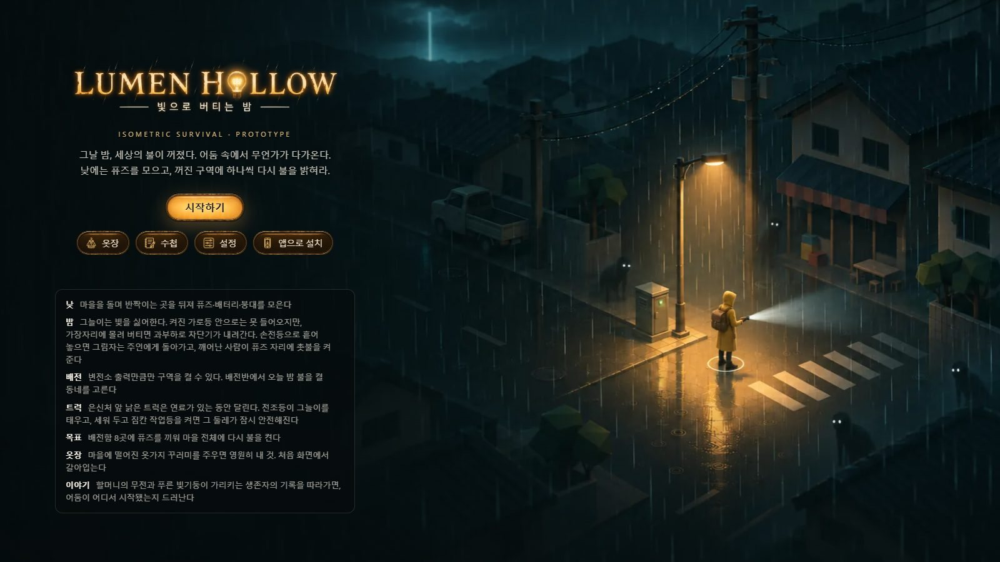
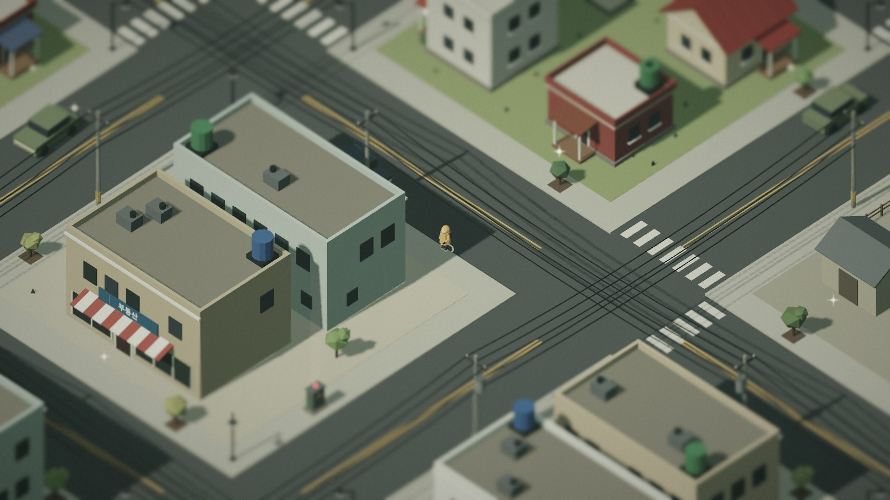
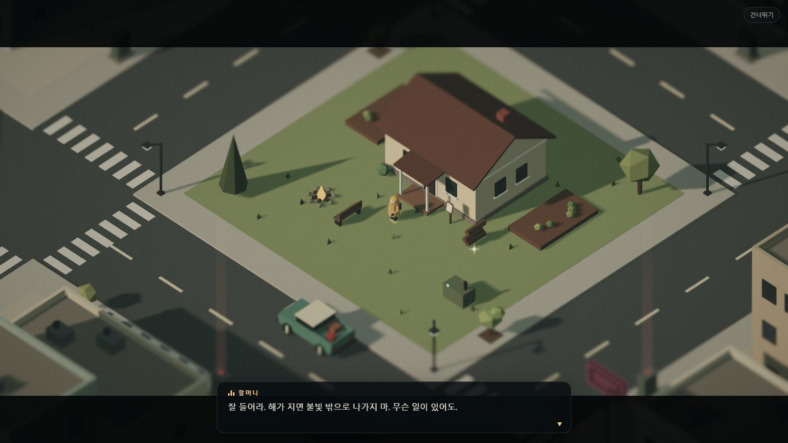
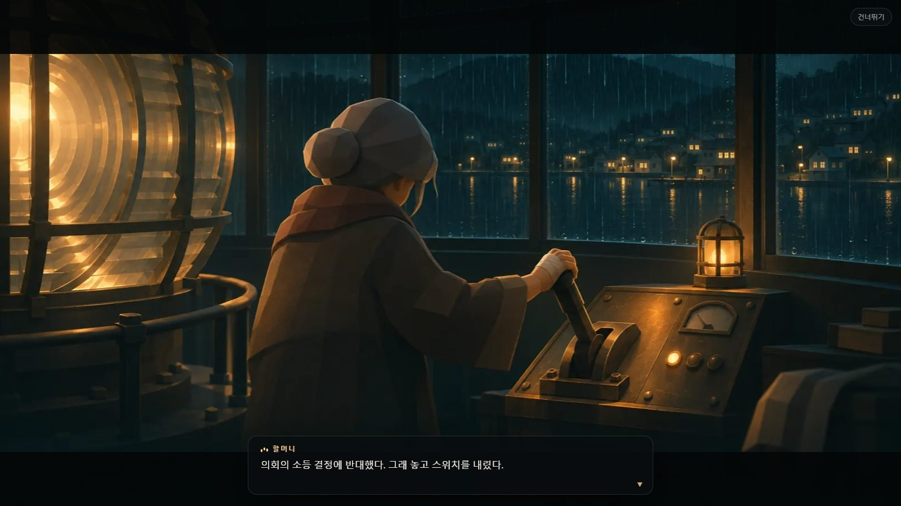

# Lumen Hollow — 빛으로 버티는 밤

정전된 작은 마을. 낮에는 골목을 뒤져 퓨즈를 모으고, 밤에는 손전등과 가로등 불빛에 기대 어둠 속 **그늘이**를 버틴다. 꺼진 배전함에 하나씩 퓨즈를 끼워 마을 전체에 다시 불을 밝히는 아이소메트릭 로우폴리 생존 게임 프로토타입입니다. 그날 밤 세상의 불이 꺼진 뒤, 할머니의 무전과 마을에 남은 생존자들의 기록을 따라가면 어둠이 어디서 시작됐는지와 마지막으로 켜야 할 불이 드러납니다.

**▶ 라이브 데모: https://jeiel85.github.io/lumen-hollow/** (설치 없이 브라우저에서 바로, 모바일 터치·가로/세로 화면 지원). 웹판은 **1장 데모**이고, 2~4장은 안드로이드 앱(플레이 스토어 준비 중)에서 이어진다.

홈 화면·바탕화면에 **앱으로 설치**할 수도 있습니다(타이틀의 "앱으로 설치", iOS는 공유 → 홈 화면에 추가). 설치하면 주소창 없이 전체 화면으로 열리고, 한 번 받은 뒤에는 인터넷 없이도 할 수 있습니다.






마을은 한국 읍내 모습이다. 골목마다 전봇대와 늘어진 전선이 있고, 양옥 옥상에는 물탱크와 장독이 있다. 함석지붕, 노란 중앙선, 한글 간판, 물 댄 논, 하늘색 1톤 트럭이 있다. 배전함을 고치면 전선을 따라 불빛이 번져 나간 뒤 동네에 불이 들어오고, 밤에는 불 들어온 동네의 간판이 켜진다.

| 아침 | 노을 |
|---|---|
|  |  |




이야기의 중요한 대화 열한 곳에서는 장면 그림이 깔린다(아래는 할머니가 등대 스위치를 내린 밤을 고백하는 장면).



## 어떻게 플레이하나요

| 시간 | 할 일 |
|---|---|
| **낮** | 마을을 돌며 반짝이는 곳을 뒤져 퓨즈·배터리·붕대·연료통을 모은다. 화살표와 붉은 신호 기둥이 가장 가까운 꺼진 배전함을 가리킨다. |
| **해질녘** | 불 켜진 구역 쪽으로 돌아온다. 첫날 밤에는 비가 내린다. |
| **밤** | 그늘이는 빛을 싫어한다. 켜진 가로등 불빛 안으로는 들어오지 못하고, 손전등으로 오래 비추면 흩어진다. 가로등 아래에서는 손전등이 충전되고 체력도 회복된다. 하지만 그늘이가 가로등 가장자리에 몰려 버티면 그 구역에 **과부하**가 걸린다. 가로등이 깜박이고 웅웅거리다 끝내 **차단기가 내려가** 구역이 어두워진다. 배전함(은신처는 발전기)에서 길게 눌러 다시 올리거나, 손전등으로 미리 흩어 놓아야 한다. 새벽이 오면 내려간 차단기는 저절로 올라간다. 손전등으로 흩어 놓은 그늘이는 잠든 주인에게 돌아간다. 옅은 빛이 가장 가까운 집으로 날아가 창가가 밝아지고, **여섯을 돌려보낼 때마다** 깨어난 누군가가 아직 숨은 퓨즈 자리에 **촛불**을 켜 둔다(단서가 적은 구역부터, 금빛 기둥은 밤에만 보인다). 그늘이는 벽을 지나오지 못하고, 손전등도 건물 너머를 비추지 못한다. 세 번째 밤부터는 등 뒤나 두 방향에서 한꺼번에 몰려와 한 방향만 비춰서는 버티기 어려워진다. 밤에는 배전반을 여는 동안에도 시간이 흐른다. |
| **배전** | 변전소 출력이 약해서 고친 구역을 다 켤 수는 없다. 은신처(자체 발전기) 말고 **2곳**까지 켤 수 있고, 배전함을 3곳 고칠 때마다 1곳씩 늘어난다. 출력이 모자랄 때 고친 구역은 꺼 둔 채로 남는다. **배전반**(Tab·B, 위쪽 전력 버튼)에서 오늘 밤 불을 켤 동네를 고른다. 내일 뒤질 쪽, 밤에 옮겨 다닐 피난처를 생각해서 고르자. 여덟 곳을 다 고치면 변전소가 제 출력을 되찾아 마을 전체가 켜진다. |
| **트럭** | 은신처 앞 도로에 낡은 1톤 트럭이 서 있다. 연료가 남은 동안 달릴 수 있고, 밤에는 전조등이 손전등처럼 그늘이를 태운다. 빠르게 들이받으면 흩어지지만, 멈춰 있으면 어두운 뒤쪽에서 다가온다. 연료는 달릴수록 줄고, 주운 연료통은 트럭에 탈 때 부어 넣는다(한 통에 40%, 넘쳐 버리지 않게 연료가 60% 이하일 때만). 퓨즈를 끼우거나 뒤지려면 내려야 한다. 세워 둔 채 운전석에서 **짐칸 작업등**을 켜면 짐칸 발전기가 연료를 쓰며 트럭 둘레를 가로등 아래처럼 지켜 준다(움직이는 피난처). 작업등도 그늘이가 몰리면 과부하로 꺼진다. |
| **밤의 변화** | 둘째 밤부터 해질녘에 그날 밤 사건이 정해진다. **짙은 안개**(멀리 안 보이고 손전등이 짧게 닿는다, 화면 밖 표시도 가까이 와서야 뜬다)나 **전압 출렁임**(곁의 가로등이 깜박인 뒤 3초쯤 꺼진다, 은신처 발전기·트럭 작업등은 그대로)이 오거나 조용히 지나간다. 같은 사건이 이틀 연달아 오지는 않는다. 둘째 밤 무렵부터 **빛먹이**(보랏빛 눈의 큰 그늘이, 가로등을 먼저 찾아가 붙어 차단기를 금세 내리고 곁에 오면 손전등이 깜박인다)와 **떼 그늘이**(작고 빠르지만 약한 무리)가 섞여 나온다. 처음 만나면 무엇인지 알려 주고 수첩 **밤의 기록**에 설명이 남는다. |
| **다른 마을** | 1장 엔딩을 본 뒤 '새로 시작'에서 **기본 마을**과 **다른 마을**(번호 1~999999)을 고를 수 있다. 다른 마을은 동네 배치가 돌거나 뒤집히고 집·가게·차·뒤질 곳 자리가 달라진다. 같은 번호는 같은 마을이라 친구에게 번호를 알려 줄 수 있다. 다른 마을에는 1장 기록과 다른 생존자의 보급품이 없고, 2~4장은 기본 마을에서 이어진다(누르면 기본 마을로 다시 연다). |
| **난이도** | 새로 시작할 때 **쉬움·보통·어려움**을 고른다. 쉬움은 그늘이가 적고 느리며 덜 아프고, 손전등이 오래 가고 과부하도 느리다(이야기를 따라가고 싶을 때). 어려움은 첫 밤부터 등 뒤·두 방향에서 몰려오고 더 많고 빠르다. 1장 판은 시작할 때 고른 단계로 끝까지 가고(이어하기에도 남는다), 2~4장은 설정 → 게임의 난이도를 바로 따른다. 최고 기록은 단계마다 따로 남는다. |
| **목표** | 배전함 8곳에 퓨즈를 끼워 9개 구역 모두에 불을 켠다. 구역을 살릴 때마다 그 동네의 가로등·창문·네온사인이 밤에 함께 켜진다. |
| **옷장** | 처음 화면의 '옷장'에서 비옷 색·모자·안경·배낭을 고른다. 처음엔 몇 가지만 있고, 나머지는 판마다 마을 어딘가에 크림색 빛기둥과 함께 떨어진 꾸러미(최대 3개)를 주우면 이 브라우저에 영구히 남는다. 능력치 없는 순수 외형이다. |
| **이야기** | 첫 판을 시작하면 할머니에게서 무전이 오고, 구역에 불이 들어올 때마다 다음 무전이 온다. 무전이 열어 준 기록은 **푸른 빛기둥**과 화면 밖 **푸른 화살표**가 가리킨다. 가까이 가서 상호작용을 길게 누르면 읽는다. 본 장면과 읽은 기록은 이 브라우저에 남아 다음 판에도 이어지고, 일시정지·처음 화면의 **수첩**에서 다시 볼 수 있다. 장면은 화면을 누르거나 Space·Enter·E로 넘기고, Esc나 "건너뛰기"로 건너뛴다. |
| **2~4장** | 안드로이드 앱에서만 한다(웹판은 1장 데모라 그 자리에 앱 안내가 뜬다). 앱에서는 2장 할머니와의 첫 대면까지 맛보기이고, 그 뒤는 한 번 결제로 열린다(Google Play 결제, 같은 구글 계정이면 다시 깔아도 열림). 마을에 첫 불을 다시 켜는 엔딩을 보면 처음 화면(또는 승리 화면)에 **다음 장** 단추가 생긴다. 나룻배로 등대섬에 건너가 할머니를 만나고(2장 인계), 강 건너 구호소에서 엄마의 행방을 찾고(3장 빈 들것), 옛 학교 별관에서 마지막 밤을 지킨다(4장 점호). 지금 할 일은 화면 위 **목표**에, 갈 곳은 푸른 화살표에 뜬다. 진행은 장면·기록을 볼 때마다 저장돼 언제 나가도 그 차례에서 이어지고, 쓰러져도 찾은 것과 돌려보낸 그림자는 남는다. 설정 요약은 [docs/story.md](docs/story.md). |
| **이어하기** | 진행 중인 판은 탭이 가려지거나 닫힐 때, 일시정지할 때, 구역을 살리거나 해가 지고 뜰 때, 그리고 15초마다 이 브라우저에 저장된다. 모바일에서 탭이 종료돼도 처음 화면의 **이어하기**로 같은 날·같은 구역·같은 소지품에서 이어 간다(그늘이는 이어할 때 새로 나타난다). 일시정지 → 처음 화면으로 나가도 판은 남는다. 이기거나 쓰러지면 지워진다. |

### 조작

| 동작 | 키보드·마우스 | 터치 |
|---|---|---|
| 이동 | WASD / 방향키 | 왼쪽 화면 드래그(가상 스틱) |
| 조준 | 마우스 커서 | 이동 방향(손전등을 켜면 8m 안의 가장 가까운 그늘이 쪽) |
| 손전등 | F 또는 클릭 | 손전등 버튼 |
| 뒤지기·퓨즈 끼우기 | E 또는 Space 길게 | 상호작용 버튼 길게 |
| 붕대 | Q | 붕대 버튼 |
| 트럭 타기·내리기 | 트럭 옆에서 E 길게 (내릴 때는 멈춘 뒤) | 상호작용(내리기) 버튼 길게 |
| 짐칸 작업등 | 운전석에서 F (멈춘 뒤) | 운전 중 작업등 버튼 |
| 차단기 올리기 | 내려간 구역의 배전함·은신처 발전기 앞에서 E 길게 | 상호작용 버튼 길게 |
| 배전반 | Tab 또는 B | 위쪽 전력 버튼 |
| 지도 | V 또는 오른쪽 위 미니맵 클릭(Esc로 닫기) | 오른쪽 위 미니맵 누르기 |
| 공유 보급품 꺼내기·고마워요 | 청록빛 상자 앞에서 E 길게 | 상호작용 버튼 길게 |
| 공유 보급품 남기기 | 인도 위에서 G → 1·2·3으로 고르기, N 문구 | '보급품 남기기' 버튼 |
| 운전 | W 가속 · S 브레이크·후진 · A/D 핸들 | 가고 싶은 쪽으로 스틱(뒤로 당기면 후진) |
| 줌 / 일시정지 / 소리 | 휠 / Esc·P / M | 설정의 카메라 거리 / 화면 오른쪽 위 버튼 |
| 무전 넘기기 / 건너뛰기 | 클릭·Space·Enter·E / Esc | 화면 누르기 / 건너뛰기 버튼 |
| 2~4장 할 일(배 타기·읽기·등 잇기·송신) | 그 자리에서 E 길게 | 상호작용 버튼 길게 |

휴대폰을 세로·가로로 돌리면 화면 배치가 바로 바뀝니다. 짧은 변에 보이는 범위를 같게 맞춰서 돌려도 캐릭터 크기는 그대로이고, 긴 변 쪽으로 시야만 넓어집니다.

### 설정

타이틀이나 일시정지 화면의 **설정**에서 바꾸고, 이 브라우저에 저장됩니다(저장소가 막힌 사생활 보호 모드에서는 화면 위에 "이번 세션에만 적용"이라고 알립니다).

| 묶음 | 항목 |
|---|---|
| 게임 | 난이도(2~4장은 바로, 1장 판은 새로 시작할 때부터), 언어(기기 설정·한국어·English, 바꾸면 다시 열림) |
| 소리 | 전체 음량, 음악(배경 음악), 환경음(비·밤 소리) |
| 화면 | 화질(낮음·보통·높음: 해상도·안티에일리어싱·그림자), 미니어처 흐림, 흔들림·붉은 점멸(움직임 줄이기를 켠 기기는 처음부터 꺼짐), FPS 표시, 전체 화면(지원하는 브라우저) |
| 조작 | 카메라 거리, 왼손 모드(터치: 스틱과 버튼 자리 바꾸기) |
| 앱 설치 | 설치 버튼 또는 브라우저별 설치 방법 안내, 오프라인 실행 준비 상태(안 됐으면 이유) |
| 온라인 보급품 | 켜기/끄기, 내 온라인 기록 지우기(처음 화면에서 연 설정에서만) |
| 기록 | 난이도별 최고 기록 보기, 기록 파일 내보내기·가져오기(옷장·이야기 진행 포함), 최고 기록 지우기 |

### 기록 보관

최고 기록·옷장·이야기 진행은 이 브라우저에만 저장됩니다. 사이트 데이터를 지우거나 다른 기기·브라우저로 옮기면 따라오지 않으니, 설정 → 기록 → **내보내기**로 `.json` 파일을 받아 두고 새 곳에서 **가져오기** 하세요. 가져오면 최고 기록은 더 좋은 값이, 모은 옷가지·본 장면·읽은 기록은 두 쪽을 합친 것이 남고(지금 기기의 진행은 줄지 않습니다), 옷차림은 파일대로 바뀝니다. 알아볼 수 없는 값은 건너뛰고 몇 개였는지 알려 줍니다. 가져오기는 처음 화면에서 연 설정에서만 됩니다(판 도중에는 진행이 바뀌지 않게). 브라우저가 공간 정리로 지우지 않도록 영구 저장도 요청합니다. 검토한 다른 방법(클라우드 동기화 등)과 이유는 [DECISIONS.md](DECISIONS.md)에 있습니다.

## 기술 구성

- **빌드 없는 정적 사이트**: 순수 ES 모듈 + [three.js](https://threejs.org/) r187(`vendor/three/`에 포함, MIT). `main`에 푸시하면 `.github/workflows/pages.yml`이 GitHub Pages로 배포한다.
- **캐시 무효화**: Pages는 모든 파일을 10분 캐시하므로, `index.html`의 진입 스크립트·스타일과 import map의 모듈 URL에 `?v=__BUILD__`를 붙이고 배포 워크플로가 커밋 SHA로 바꾼다. **`src/`에 모듈을 추가하면 import map과 `sw.js`의 `MODULES`에도 등록**해야 하며, 빠지면 배포가 실패한다.
- **PWA**: `manifest.webmanifest`(전체 화면, 방향 자유), `icons/`, 서비스 워커 `sw.js`. 페이지는 네트워크 우선, `?v=` 붙은 파일은 캐시 우선으로 오프라인 실행을 지원한다. 로컬 개발에서는 서비스 워커를 쓰지 않는다(`?sw`로 켬). 자세한 이유는 [DECISIONS.md](DECISIONS.md).
- **절차적 마을**: 5×5 블록(주택가·상가·약국·골목식당·공원(정자·운동기구)·농장·헛간·급수탑)을 고정 시드로 생성하고, 정적 지오메트리 수천 개를 정점 색상 메시 하나로 합쳐 드로우콜을 줄였다.
- **조명**: 시간대 키프레임(아침의 옅은 민트 → 오후의 주황 → 비 오는 밤의 청록)으로 해·달·환경광·색보정을 보간. 가까운 광원만 고정 개수의 PointLight로 비추고(셰이더 재컴파일 방지), 나머지는 인스턴싱한 빛 웅덩이로 표현.
- **후처리**: HDR 렌더 타깃 → 블룸 → 틸트시프트(미니어처 느낌) → 톤매핑·채도·비네트·그레인.
- **소리**: 음원 파일 없이 WebAudio로 빗소리·밤의 저음·효과음과 배경 음악을 합성. 음악은 처음 화면·낮·해질녘·밤·새벽·이야기 장면마다 음계와 화음 진행이 다르고(`src/music.js`), 그늘이가 다가오거나 음악 신호가 울리면 줄어든다.
- **그림**: 처음 화면의 키 아트·로고, 메뉴 패널·버튼·아이콘, 이야기 컷신(`art/`, `art/story/`)은 코덱스(OpenAI Codex) 이미지 생성으로 만든 원본을 고르고 다듬은 WebP다. 서비스 워커가 미리 받아 오프라인에서도 보이며, 쓰는 곳·사전 캐시·폴더의 짝은 `tests/node/sw.test.mjs`가 검사한다. 컷신은 대본 줄의 `art`로 단다(`src/script.js` 머리말).

```
index.html, style.css   화면 골격과 HUD
art/                    처음 화면·메뉴 그림, art/story/ 이야기 컷신 그림
src/main.js             게임 루프·상태·상호작용
src/world.js            마을 생성, 충돌, 구역 전력(출력 한도·과부하·차단기), 광원 풀
src/env.js              낮밤 주기, 해·달, 비
src/post.js             블룸·틸트시프트·색보정
src/player.js           캐릭터, 손전등
src/wardrobe.js         옷장: 옷가지 목록·저장, 모자·안경·배낭 모델, 마을에 떨어진 꾸러미, 옷장 화면
src/vehicle.js          탈 수 있는 1톤 트럭: 운전·충돌·전조등·연료·바퀴 자국·짐칸 작업등
src/wisps.js            돌아가는 그림자(집으로 날아가는 빛)와 깨어난 사람이 켠 촛불 단서
src/shades.js           그늘이(적) AI
src/difficulty.js       난이도 단계 값(그늘이 수·속도·피해, 배터리, 과부하, 새 그늘이가 나오는 밤)
src/nights.js           밤의 변화: 그늘이 종류(빛먹이·떼), 밤 사건(안개·출렁임) 고르기, 처음 만난 것 기록
src/input.js            키보드·마우스·터치
src/grid.js             배전반 화면: 오늘 밤 켤 구역 고르기(변전소 출력 한도)
src/hud.js, audio.js    HUD, 합성 사운드
src/music.js            합성 배경 음악(분위기별 음계·화음 진행)
src/script.js           이야기 대본: 1~4장 장면과 기록의 글, 장 목표 문구(설정 요약은 docs/story.md)
src/story.js            이야기 진행 저장, 1장 기록 소품·표식 배치, 호수와 등대섬 풍경
src/chapters.js         2~4장: 섬·강 건너 학교 무대, 인물, 차례 계산과 진행 저장(lumen.chapters)
src/minimap.js          구석 미니맵과 전체 지도(아이소 카메라 방향으로 45° 돌려 그림)
src/dialogue.js         무전 장면(대화 컷신)·기록 읽기·수첩 화면
src/settings.js         설정 저장·검증, 설정 화면 입력 연결
src/i18n.js             화면 언어(기기 언어 기본), tr() — 한국어 원문을 열쇠로 영어 사전(src/i18n.en.js)에서 찾기, index.html 고정 글 바꾸기
src/script.en.js        영어 대본(src/script.js와 같은 id·줄 수)
src/store.js            2~4장 한 번 결제: Play 결제(앱)·흉내 가게(로컬 개발), 마지막 구매 상태
src/records.js          최고 기록, 기록 파일(v2: 옷장·이야기 진행 포함) 내보내기·가져오기
src/pwa.js              서비스 워커 등록, 앱 설치 안내, 전체 화면
src/storage.js          localStorage 안전 접근
src/runsave.js          진행 중인 판 저장·검증·되돌리기(이어하기)
sw.js                   서비스 워커(오프라인 캐시)
manifest.webmanifest    PWA 설치 정보, icons/ 아이콘
src/online.js           공유 보급품 API 호출, 이 브라우저의 보급품 기록
src/caches.js           마을에 놓인 공유 보급품 표시, 빈 슬롯 찾기
src/slots.js            공유 보급품 슬롯 좌표(서버와 같은 표를 쓴다)
server/                 공유 보급품 서버(Cloudflare Workers + D1). 실행·배포는 server/README.md
```

## 공유 보급품 (온라인)

다른 플레이어가 마을 인도에 남긴 붕대·연료통·배터리 팩을 꺼내 쓰고, 고마워요를 보낼 수 있다. 상자 하나는 8명이 하나씩 꺼내 쓸 수 있고, 같은 상자는 24시간에 한 번만 꺼낼 수 있다. 남길 때는 인도 위에서 G(모바일은 '보급품 남기기' 버튼)를 누른다. 설계와 규칙은 [docs/online-caches.md](docs/online-caches.md)에 있다.

서버는 Cloudflare Workers + D1(무료 플랜)에서 돈다. 서버에 닿지 못하면 보급품 없이 혼자 하는 판으로 그대로 진행된다. `src/online.js`의 `ONLINE_API`를 비우면 기능 전체가 꺼진다.

**개인정보**: 전체 처리방침은 [privacy.html](privacy.html)(배포 주소 https://jeiel85.github.io/lumen-hollow/privacy.html, 게임 설정 → 정보)에 있다. 처음 쓸 때 브라우저에서 만든 무작위 ID와, 보급품의 위치·종류·고른 문구·사용 기록만 서버에 저장한다. 이름, 자유 텍스트, 원문 IP는 저장하지 않는다. 남용 방지용으로 날짜마다 바뀌는 IP 해시를 이틀 동안만 둔다. 다만 호스팅(Cloudflare)의 접근 기록에는 IP가 남을 수 있다. 사용·고마워요·접속 기록은 90일 뒤 지우고 일별 합계만 남긴다. 설정 화면에서 기능을 끌 수 있고(끄면 아무것도 보내지 않는다), 같은 곳의 "내 온라인 기록 지우기"로 서버의 내 기록을 지울 수 있다. 온라인을 켜 두면 장면을 끝까지 봤는지·건너뛰었는지, 장에 들어가고 마쳤는지를 누구인지 없이 날짜별 횟수로만 보낸다(플레이어 ID·IP를 함께 저장하지 않음). 400일 뒤 지운다.

## 안드로이드 앱

플레이 스토어용 앱은 같은 게임 파일을 Capacitor로 감싼다(`android/`, `capacitor.config.json`, `scripts/build-app.mjs`). 빌드·서명·에뮬레이터 확인 방법은 [android/README.md](android/README.md), 스토어 등록 문구·신고 답안·그래픽·스크린샷은 [store/README.md](store/README.md)에 있다.

## 로컬에서 실행

ES 모듈이라 `file://`로는 열리지 않습니다. 저장소 폴더에서 아무 정적 서버나 띄우면 됩니다.

```bash
python -m http.server 8000
```

브라우저에서 `http://localhost:8000` 을 엽니다. 로컬에서는 공유 보급품이 운영 서버에 연결되지 않아(운영 서버는 배포 주소만 허용) 혼자 하는 판으로 진행됩니다. 온라인 기능을 시험하려면 [server/README.md](server/README.md)의 로컬 서버를 띄우고 `?api=`로 연결합니다.

### URL 파라미터

| 파라미터 | 설명 |
|---|---|
| `?hour=21` | 시작 시각(0~24). 밤 장면을 바로 보고 싶을 때 |
| `?start=1` | 타이틀을 건너뛰고 바로 새 판을 시작(이어할 판이 있어도 덮어쓴다) |
| `?debug` | 콘솔에 `window.lumen` 개발용 핸들을 노출(`lumen.step(초)`로 고정 간격 시뮬레이션) |
| `?sw` | 로컬 개발에서도 서비스 워커를 등록(오프라인·설치 시험용). 끌 때는 `?sw` 없이 다시 열면 해제된다 |
| `?app` | 로컬 개발(localhost·127.0.0.1)에서만: 앱처럼 2~4장을 연다(웹판은 1장 데모). 2~4장 브라우저 시험이 붙인다. 배포 주소에서는 무시 |

시험은 [tests/README.md](tests/README.md): Node 시험(`node --test "tests/node/*.test.mjs"`, PR마다 자동)과 헤드리스 Chrome 브라우저 시험(`tests/e2e/`).

### 마을 생성 약속(고칠 때 꼭 지킬 것)

공유 보급품의 막힌 슬롯 목록(`server/src/slots.js`)과 이야기 기록 자리가 마을 배치에 묶여 있다. 마을 생성 난수(`world.js`의 `rng`)의 호출 순서가 바뀌면 뒤질 곳·나무·충돌체 자리가 바뀌어 서버 약속과 기록 자리가 어긋난다.

- 새 장식은 **장식 전용 난수(`this.deco`)** 나 블록별로 따로 씨를 둔 난수(공원 정자처럼)만 쓴다. 마을 난수 `rng`를 새로 부르거나 순서를 바꾸지 않는다.
- 인도 위 슬롯 1m 안에는 충돌체를 두지 않는다.
- 확인: `node --test "tests/node/*.test.mjs"`(기록 자리·슬롯 일치), `server/`에서 `npm test`. 일부러 바꿨다면 `SLOT_LAYOUT`을 올리고 `npm run gen-slots`, 기록 자리는 `tests/node/gen-fixtures.mjs`.
- 이 약속은 **기본 마을(번호 0)** 의 것이다. 다른 마을 번호(#59)는 씨가 달라 처음부터 다른 마을이고, 생성 규칙을 바꾸면 `tests/node/village.test.mjs`(시작 자리·트럭 자리·배전함·뒤질 곳에 닿는지)로 확인한다. 다른 마을에만 거는 규칙은 `this.village !== DEFAULT_VILLAGE`로 묶어 기본 마을의 난수 순서를 바꾸지 않는다.

## 현재 상태와 다음 단계

반응을 보기 위한 프로토타입입니다. 데스크톱(RTX 5060, Chrome)에서 60fps를 확인했고, 저사양·실제 모바일 기기 성능은 아직 측정 전입니다. 견고성 개선 후보는 이슈 `Hardening candidates`에서 관리합니다.

반응이 괜찮으면 해 볼 만한 것들:

- 2장: 선착장의 나룻배를 타고 호수를 건너 등대의 할머니에게 가기
- 그늘이 종류 추가(빛을 꺼뜨리는 녀석, 무리 지어 다니는 녀석), 밤마다 달라지는 사건
- 은신처 꾸미기와 마을 사람 구출 같은 코지 요소
- 날씨(안개·눈), 계절에 따른 조명 변화
- 맵 변형(시드 선택)

## 라이선스

**2026-11-08부터 모든 권리 보유입니다.** 저장소는 공개되어 있어 코드를 볼 수 있지만, 코드·그림·글·세계관을 허락 없이 가져다 쓰거나 다시 배포·판매할 수 없습니다. 공식 배포판을 하는 영상·방송·스크린샷·리뷰는 수익 창출을 포함해 자유롭게 올려도 됩니다. 조건은 [LICENSE](LICENSE), 안내는 [LICENSE-CONTENT.md](LICENSE-CONTENT.md)에 있습니다.

| 구분 | 라이선스 |
|---|---|
| 지금 버전의 코드·콘텐츠 | 모든 권리 보유 ([LICENSE](LICENSE)) |
| 이전 버전(`LICENSE`가 MIT였던 v0.1.0 ~ v0.14.x) | 그 커밋의 조건: 코드 MIT, 콘텐츠 CC BY 4.0. 이미 준 허락은 그대로이고, 그 뒤 더하거나 고친 부분은 지금 조건을 따른다 |
| three.js (`vendor/three/`) | MIT ([vendor/three/LICENSE](vendor/three/LICENSE)) |

바꾼 이유는 [DECISIONS.md](DECISIONS.md)의 "라이선스 전환"에 있습니다.
